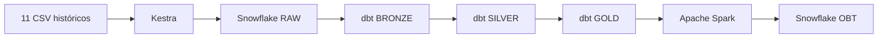

# OralSolutions — PSet2

Proyecto de maestría en Ciencia de Datos que implementa un pipeline ELT para preparar datos odontológicos sintéticos destinados a la futura predicción del abandono de tratamientos. Integra ingesta orquestada con Kestra, almacenamiento y transformación en Snowflake con dbt, y construcción de una tabla analítica con Apache Spark.

**Alcance de esta entrega:** preparación, transformación y validación de datos; modelo dimensional Gold y OBT de puntos candidatos. El target de abandono a 60 días, el entrenamiento y la evaluación predictiva quedan fuera del alcance.

**Estado de validación:** el pipeline maestro se ejecutó correctamente en el equipo de desarrollo el **12 de noviembre de 2026**, con **3 subflujos aprobados** y una duración total de **5 min 48,95 s**, según el resultado comunicado por el autor. Los logs y artefactos locales de dbt respaldan **28 modelos correctos y 177 pruebas aprobadas** con las versiones declaradas. La reproducción independiente en otra computadora y con otra cuenta Snowflake todavía no se ha comprobado.

## Arquitectura



| Etapa | Implementación y salida |
| --- | --- |
| Origen | `data/raw/`: actividad histórica de 2024–2025; datos sintéticos. |
| RAW | Kestra sube los archivos al stage `ORALSOLUTIONS_DW.RAW.RAW_CSV_STAGE`, carga tablas auxiliares e inserta IDs nuevos en las 11 tablas originales. Las columnas RAW son `VARCHAR`. |
| Bronze | 11 tablas `BRZ_*`; conversión de tipos mediante `TRY_CAST`. |
| Silver | 11 tablas `SLV_*`; normalización selectiva de correos, métodos de contacto y textos vacíos, con pruebas de integridad y reglas de negocio. |
| Gold | `FACT_SESIONES_TRATAMIENTO` y cinco dimensiones: `DIM_PACIENTE`, `DIM_ODONTOLOGO`, `DIM_PROCEDIMIENTO`, `DIM_ESTADO` y `DIM_FECHA`. Grano del hecho: una sesión de tratamiento. |
| OBT | `spark/build_obt.py` consolida Gold, calcula antecedentes y escribe `ORALSOLUTIONS_DW.OBT.OBT_RIESGO_ABANDONO`. |

## Estructura del repositorio

```text
.
├── README.md
├── docker-compose.yml
├── Dockerfile.dbt
├── .env.example
├── .gitignore
├── config/dbt/
│   ├── profiles.example.yml      # Plantilla pública del perfil dbt
│   └── profiles.yml              # Configuración privada; excluida de Git
├── data/raw/                     # 11 CSV de entrada
├── sql/
│   ├── 01_setup_snowflake.sql     # Base de datos y cinco esquemas
│   ├── 02_create_raw_tables.sql   # Tablas RAW, formato CSV y stage
│   └── 03_setup_backfill_demo.sql # Tabla independiente de demostración
├── kestra/
│   ├── main/                     # Maestro, ingesta, dbt, Spark y backfill
│   └── test/                     # Diagnósticos opcionales
├── dbt/
│   ├── dbt_project.yml
│   ├── macros/generate_schema_name.sql
│   ├── models/{bronze,silver,gold}/
│   ├── tests/{silver,gold}/
│   ├── analyses/
│   ├── seeds/
│   └── snapshots/
├── spark/
│   ├── build_obt.py
│   └── test_conexion.py
├── quality/                      # Perfilado y validaciones Python
└── docs/evidencias/              # Capturas de ejecuciones
```

Los flujos operativos están en `kestra/main/` y los diagnósticos en `kestra/test/`. Los directorios locales `dbt/target/`, `dbt/logs/`, `.venv/` y `logs/` contienen artefactos generados, están excluidos de Git y no son requisitos de un clon limpio. `config/dbt/profiles.yml` se crea a partir de su plantilla durante la configuración.

## Requisitos y dependencias

- Docker Desktop con contenedores Linux y Docker Compose. El entorno validado es Windows; para los ejecutores temporales de Kestra se debe indicar la ruta absoluta del proyecto visible para el motor Docker.
- Acceso del motor Docker a las carpetas montadas y al socket `/var/run/docker.sock`, utilizado por Kestra para lanzar contenedores de tareas.
- Cuenta Snowflake, usuario propio y autenticación por contraseña compatible con la política de esa cuenta. Los flujos actuales no implementan autenticación por clave ni un paso interactivo de MFA.
- Acceso al rol `ACCOUNTADMIN` y a un warehouse llamado `COMPUTE_WH`, porque los SQL y los flujos JDBC los fijan explícitamente. No hay un script de creación de usuario, rol, warehouse o concesión de permisos.
- Red hacia Snowflake, los registros de imágenes y los repositorios Maven utilizados por `spark-submit`.
- Python y `pandas` para el diagnóstico local opcional. No se incluyen `requirements.txt` ni un archivo de bloqueo de estas dependencias.

| Componente | Versión declarada |
| --- | --- |
| PostgreSQL | Imagen `postgres:18` |
| Kestra | Imagen `kestra/kestra:v2.0.7` |
| Spark | Imagen `apache/spark:3.5.3` |
| Python del contenedor dbt | Imagen base `python:3.11-slim` |
| dbt Core | `1.10.15` |
| Adaptador Snowflake de dbt | `1.10.2` |
| Conector Spark–Snowflake | `net.snowflake:spark-snowflake_2.12:3.2.3-spark_3.5` |
| JDBC Snowflake para Spark | `net.snowflake:snowflake-jdbc:4.0.2` |

`Dockerfile.dbt` instala `git`, dbt Core y el adaptador Snowflake. No hay `packages.yml` de dbt ni un paso `dbt deps` declarado. Spark usa `local[*]` y configura `spark.driver.memory=2g`; el repositorio no establece un requisito total de memoria del equipo.

## Configuración con credenciales propias

### 1. Archivo `.env`

Todos los comandos PowerShell de este documento parten de la **raíz del repositorio**, salvo indicación expresa. Sustituir la ruta de ejemplo por la ubicación del clon:

```powershell
Set-Location 'C:\ruta\pset_2'
if (-not (Test-Path -LiteralPath '.env')) {
    Copy-Item -LiteralPath '.env.example' -Destination '.env'
}
```

Completar `.env` localmente con credenciales propias y reemplazar todos los marcadores de la plantilla. No se necesita el archivo privado del autor. `.gitignore` excluye `.env` y `.env.*`, con excepción de `.env.example`.

| Variable de `.env.example` | Uso y formato |
| --- | --- |
| `KESTRA_DB_PASSWORD` | Contraseña propia de PostgreSQL para el usuario y la base `kestra`. |
| `KESTRA_ADMIN_EMAIL` | Usuario de acceso a la interfaz de Kestra. |
| `KESTRA_ADMIN_PASSWORD` | Contraseña propia de acceso a Kestra. |
| `ENV_SNOWFLAKE_URL` | URL JDBC: `jdbc:snowflake://<identificador_cuenta>.snowflakecomputing.com`. |
| `ENV_SNOWFLAKE_USER` | Usuario propio de Snowflake para las tareas JDBC de Kestra. |
| `SECRET_SNOWFLAKE_PASSWORD` | Contraseña Snowflake codificada en Base64 UTF-8, sin saltos de línea ni espacios externos. La usan Kestra y ambos scripts Spark. |
| `SNOWFLAKE_ROLE` | Está en la plantilla, pero los flujos JDBC no la leen: fijan `ACCOUNTADMIN`. |
| `SNOWFLAKE_WAREHOUSE` | Está en la plantilla, pero los flujos JDBC no la leen: fijan `COMPUTE_WH`. |
| `SNOWFLAKE_DATABASE` | Está en la plantilla, pero los flujos JDBC no la leen: fijan `ORALSOLUTIONS_DW`. |
| `SNOWFLAKE_SCHEMA` | Está en la plantilla, pero los flujos JDBC no la leen: fijan `RAW`. |
| `SF_ACCOUNT` | Identificador de cuenta, sin `https://`, sin prefijo JDBC y sin `.snowflakecomputing.com`. Spark añade ese sufijo. |
| `SF_USER` | Usuario propio para Spark; mantenerlo coherente con `ENV_SNOWFLAKE_USER`. |
| `SF_PASSWORD` | Está en la plantilla, pero los scripts Spark actuales **no la utilizan**. |
| `SF_WAREHOUSE` | Warehouse utilizado por Spark; para esta configuración, `COMPUTE_WH`. |
| `SF_DATABASE` | Base utilizada por Spark: `ORALSOLUTIONS_DW`. Definirla expresamente. |
| `SF_GOLD_SCHEMA` | Esquema de lectura Spark: `GOLD`. |
| `SF_OBT_SCHEMA` | Esquema de escritura Spark: `OBT`. |
| `SF_ROLE` | Rol autorizado para leer Gold y crear o reemplazar la OBT. |
| `ENV_KESTRA_HOST_PROJECT_PATH` | Ruta absoluta de la raíz del proyecto vista por el motor Docker. Se utiliza como `envs.kestra_host_project_path` en los montajes de los subflujos dbt y Spark. |

Kestra expone `ENV_SNOWFLAKE_URL` como `envs.snowflake_url` y `ENV_SNOWFLAKE_USER` como `envs.snowflake_user`. `secret('SNOWFLAKE_PASSWORD')` resuelve y decodifica `SECRET_SNOWFLAKE_PASSWORD`. Este comportamiento se describe en la documentación oficial de [variables de entorno](https://kestra.io/docs/expressions/context/index) y [secretos](https://kestra.io/docs/concepts/secret).

Para obtener el valor Base64, ejecutar **localmente en PowerShell**, con Python disponible:

```powershell
python -c "import base64,getpass; print(base64.b64encode(getpass.getpass('Contraseña Snowflake: ').encode('utf-8')).decode('ascii'))"
```

Copiar el resultado únicamente a `SECRET_SNOWFLAKE_PASSWORD` en el archivo privado. Base64 es reversible: no publicar ese valor, contraseñas ni perfiles en capturas o entregables.

El subflujo Spark ejecuta `. /config/.env` dentro de Bash. Guardar `.env` como **UTF-8 sin BOM y con finales de línea LF**, usando el selector de codificación y finales de línea del editor. Las asignaciones `NOMBRE=valor` deben ser válidas también en shell; usar comillas simples para proteger valores literales cuando corresponda. Evitar espacios externos e interpolaciones involuntarias. La normalización que hace ese flujo ocurre después de leer el archivo y no sustituye un formato válido.

### 2. Perfil portable de dbt

Crear la configuración privada desde la plantilla pública, en la **raíz del repositorio y en PowerShell**, sin sobrescribir un perfil existente:

```powershell
if (-not (Test-Path -LiteralPath './config/dbt/profiles.yml')) {
    Copy-Item -LiteralPath './config/dbt/profiles.example.yml' -Destination './config/dbt/profiles.yml'
}
```

Editar únicamente `config/dbt/profiles.yml` en el equipo local:

- Conservar el perfil `oralsolutions`, el destino `dev`, el tipo `snowflake`, `database: ORALSOLUTIONS_DW` y `schema: BRONZE`. La plantilla define `threads: 4`.
- En `account`, colocar el identificador de cuenta sin protocolo ni `.snowflakecomputing.com`; en `user`, el usuario propio; en `password`, su contraseña original, **sin codificación Base64**.
- Reemplazar los marcadores `role` y `warehouse` por valores autorizados. Usar `ACCOUNTADMIN` y `COMPUTE_WH` para mantener la misma configuración de los SQL y flujos JDBC incluidos.
- Mantener coherentes la cuenta, el usuario y la contraseña entre este perfil y `.env`. La plantilla usa valores explícitos y no lee las variables de `.env` mediante `env_var()`.

El servicio Compose monta `./config/dbt/profiles.yml` en `/root/.dbt/profiles.yml:ro`. El subflujo Kestra monta la carpeta `config/dbt/` en `/root/.dbt:ro`. Ninguno depende del directorio personal `.dbt` del autor. El archivo privado está excluido mediante `/config/dbt/profiles.yml`; no introducir credenciales en `profiles.example.yml` ni adjuntar el perfil privado a la entrega.

La macro `generate_schema_name` usa directamente los esquemas personalizados `bronze`, `silver` y `gold`; no les antepone el esquema del perfil.

### 3. Ruta del proyecto visible para Docker

En `.env`, definir `ENV_KESTRA_HOST_PROJECT_PATH` con la raíz del proyecto **vista por el motor Docker**, sin barra final. Kestra la utiliza para montar `dbt/`, `config/dbt/`, `spark/` y `.env` en los contenedores temporales.

Ejemplo ilustrativo para Docker Desktop sobre Windows: si el clon está en `C:\proyectos\pset_2`, la ruta utilizada por el motor puede ser:

```dotenv
ENV_KESTRA_HOST_PROJECT_PATH='/run/desktop/mnt/host/c/proyectos/pset_2'
```

Sustituirla por la ruta real de la instalación. No copiar literalmente el marcador de `.env.example`, usar rutas relativas ni confundir esta variable con `/app/dbt` o `/opt/spark/work-dir`, que son destinos internos. En otro sistema operativo, indicar la ruta equivalente que pueda montar su motor Docker. Su disponibilidad debe comprobarse al ejecutar los subflujos; una ruta válida en PowerShell no garantiza que el motor pueda acceder a ella.

## Inicialización de Snowflake

Ejecutar estos pasos en una **hoja SQL de Snowsight, dentro de la cuenta propia**. Abrir los archivos del repositorio y ejecutar su contenido; no son comandos de PowerShell.

1. Seleccionar un rol autorizado para crear la base y los esquemas. Confirmar que el usuario puede asumir `ACCOUNTADMIN` y que existe `COMPUTE_WH`. Su aprovisionamiento no está automatizado aquí.
2. Ejecutar [sql/01_setup_snowflake.sql](sql/01_setup_snowflake.sql): crea `ORALSOLUTIONS_DW` y los esquemas `RAW`, `BRONZE`, `SILVER`, `GOLD` y `OBT`.
3. Ejecutar [sql/02_create_raw_tables.sql](sql/02_create_raw_tables.sql): selecciona `ACCOUNTADMIN`, `COMPUTE_WH` y `RAW`; crea las 11 tablas RAW, `CSV_RAW_FORMAT` y el stage interno **`ORALSOLUTIONS_DW.RAW.RAW_CSV_STAGE`**. El propio script incluye la comprobación del stage.
4. Verificar los objetos antes de iniciar la ingesta:

```sql
SHOW STAGES LIKE 'RAW_CSV_STAGE' IN SCHEMA ORALSOLUTIONS_DW.RAW;
SHOW TABLES IN SCHEMA ORALSOLUTIONS_DW.RAW;
SHOW FILE FORMATS IN SCHEMA ORALSOLUTIONS_DW.RAW;
```

`CSV_RAW_FORMAT` omite la cabecera, admite campos entre comillas, conserva cadenas vacías y espacios, y rechaza diferencias en el número de columnas. La ingesta usa `ON_ERROR = ABORT_STATEMENT`.

`03_setup_backfill_demo.sql` es opcional y no forma parte del arranque. Si se utiliza para estudiar la demostración, requiere que `RAW.APPOINTMENTS` ya contenga datos.

## Docker Compose

### Servicios y persistencia

| Servicio exacto | Función | Acceso o montaje relevante |
| --- | --- | --- |
| `postgres` | Repositorio y cola de Kestra; comprobación de salud con `pg_isready`. | Volumen `datos_postgres`; sin puerto publicado. |
| `kestra` | Servidor `standalone`; espera a PostgreSQL saludable. | `127.0.0.1:8080`; volumen `datos_kestra`; CSV en `/data/raw:ro`; dbt en `/app/dbt:ro`; socket Docker y `/tmp/kestra-wd`. |
| `spark` | Contenedor disponible para ejecuciones manuales. | `127.0.0.1:4040` durante una aplicación Spark; scripts en `/opt/spark/work-dir`; caché `spark_ivy`. |
| `dbt` | Imagen construida con `Dockerfile.dbt`; permanece disponible con `tail`. | Proyecto en `/app/dbt`; perfil portable en `/root/.dbt/profiles.yml:ro`. |

Los subflujos Docker de Kestra lanzan **otros contenedores**; no ejecutan los servicios persistentes `dbt` y `spark` mediante `docker compose exec`. La caché `spark_ivy` del servicio Spark tampoco se monta en el subflujo Kestra.

### Construcción y arranque

Antes del arranque, deben existir `.env` y `config/dbt/profiles.yml`, ambos completos con la configuración propia. Definir también la ruta del proyecto visible para Docker. No se requiere instalar dbt ni Spark directamente en Windows.

Ejecutar desde la **raíz, en PowerShell**:

```powershell
docker compose --project-name pset_2 config --quiet
docker compose --project-name pset_2 build dbt
docker compose --project-name pset_2 up -d postgres kestra spark dbt
docker compose --project-name pset_2 ps
docker compose --project-name pset_2 logs --tail 100 kestra
docker compose --project-name pset_2 exec dbt dbt debug
```

Se fija `--project-name pset_2` para que la imagen construida se llame `pset_2-dbt:latest`, exactamente como exige `test_dbt_docker`, aunque la carpeta del clon tenga otro nombre. Ambos ejecutores usan `pullPolicy: NEVER`; la imagen dbt debe estar construida y `apache/spark:3.5.3` debe estar disponible localmente. El arranque del servicio `spark` obtiene esta última imagen. `dbt debug` comprueba el perfil y la conexión; no construye modelos.

Acceder a [Kestra local](http://localhost:8080) con `KESTRA_ADMIN_EMAIL` y `KESTRA_ADMIN_PASSWORD`. Tras cambiar `.env`, volver a ejecutar el comando `up -d` anterior para aplicar las variables nuevas a los servicios. Usar `config --quiet` para validar sin imprimir la configuración expandida y sus credenciales.

Para detener los servicios conservando sus volúmenes, desde la misma raíz:

```powershell
docker compose --project-name pset_2 down
```

Este comando no borra las tablas Snowflake. No se necesita eliminar los volúmenes para repetir una ejecución.

## Kestra: importación y ejecución

### Flujos disponibles

Todos usan el namespace **`oralsolutions`**.

| Archivo | ID | Función |
| --- | --- | --- |
| `kestra/main/ingest_raw_oralsolutions.yml` | `ingest_raw_oralsolutions` | Ingesta de los 11 CSV, secuencial por archivo. |
| `kestra/main/pipeline_oralsolutions.yml` | `pipeline_oralsolutions` | Maestro: ingesta RAW → dbt → Spark. |
| `kestra/main/backfill_appointments.yml` | `backfill_appointments` | Recuperación por fechas de citas ausentes en RAW. |
| `kestra/test/test_snowflake.yml` | `test_snowflake` | Diagnóstico de conexión JDBC. |
| `kestra/test/ingest_patients.yml` | `ingest_patients` | Prueba aislada de carga de pacientes mediante `COPY INTO` directo; no implementa la inserción incremental del flujo principal. |
| `kestra/test/test_retries.yml` | `test_retries` | Fallo deliberado para comprobar reintentos y registro de errores. |
| `kestra/main/test_dbt_docker.yml` | `test_dbt_docker` | Subflujo operativo: ejecuta `dbt run` y `dbt test`; **dependencia obligatoria del maestro**. |
| `kestra/main/test_spark_docker.yml` | `test_spark_docker` | Subflujo operativo: ejecuta `build_obt.py`, valida y escribe la OBT; **dependencia obligatoria del maestro**. |

Los IDs `test_dbt_docker` y `test_spark_docker` se conservan en los YAML, pero estos dos flujos forman parte de la ejecución principal y están en `kestra/main/`. Los archivos de `kestra/test/` son pruebas opcionales y no son invocados por el maestro.

### Importar las definiciones

Compose no monta ni importa automáticamente los YAML de Kestra. Desde la **interfaz web de Kestra**:

1. Abrir la sección de flujos. Crear un flujo en el editor, pegar el contenido completo del YAML correspondiente y guardarlo conservando su `id` y `namespace`. Este procedimiento registra la definición sin depender de una CLI adicional.
2. Registrar los tres subflujos, copiando sus archivos de `kestra/main/`: `ingest_raw_oralsolutions`, `test_dbt_docker` y `test_spark_docker`.
3. Registrar `pipeline_oralsolutions` desde su YAML de `kestra/main/`, manteniendo los `flowId` de sus dependencias.
4. Registrar `backfill_appointments` si se realizará la recuperación histórica. Para diagnosticar la conexión JDBC, registrar también `kestra/test/test_snowflake.yml`. `test_retries` e `ingest_patients` son opcionales.
5. Confirmar la validación del editor y revisar los flujos guardados en `oralsolutions`. Si ya existían versiones anteriores, actualizar los flujos con el contenido actual y comprobar la revisión guardada antes de ejecutarlos.

Solo el maestro declara un trigger diario: **`pipeline_diario`**, cron **`0 2 * * *`**, a las **02:00 de `America/Guayaquil`**, con `allowConcurrent: false` y `recoverMissedSchedules: NONE`. La ingesta no tiene programación propia. Durante la configuración inicial, mantener deshabilitado el horario del maestro desde la gestión de triggers hasta validar una ejecución manual. Si la instancia conserva flujos antiguos con otros IDs y programaciones, deshabilitarlos para evitar ejecuciones adicionales.

### Ejecutar el pipeline maestro

Una vez inicializado Snowflake, completados `.env` y el perfil dbt, disponibles las imágenes e importados los flujos:

1. Como diagnóstico opcional, abrir en Kestra `oralsolutions.test_snowflake`, pulsar **Execute** y comprobar el resultado de conexión.
2. Abrir `oralsolutions.pipeline_oralsolutions` y pulsar **Execute**. No requiere parámetros de entrada ni una carga o construcción manual previa: el maestro realiza las tres etapas en orden.
3. Comprobar en Gantt y logs la secuencia `ingesta_raw` → `transformar_y_validar_dbt` → `construir_obt_spark`. Cada tarea declara `wait: true` y `transmitFailed: true`: espera al subflujo y propaga su fallo antes de continuar.
4. Revisar los conteos RAW por archivo, los 28 modelos, las 177 pruebas dbt y las validaciones de Spark. Confirmar el estado exitoso del maestro y de sus tres subflujos.
5. Consultar Gold y OBT con las consultas de resultados de este documento. Activar el horario diario del maestro solo después de validar la ejecución manual. Los horarios omitidos no se recuperan automáticamente.

## dbt: ejecución y validación manual

Esta ejecución independiente es útil para diagnóstico; no es un paso adicional obligatorio después de ejecutar el maestro. Realizarla después de cargar RAW. Los comandos parten de la **raíz en PowerShell** y se ejecutan dentro del servicio `dbt`, cuyo directorio de trabajo es `/app/dbt`. El perfil es `config/dbt/profiles.yml`:

```powershell
docker compose --project-name pset_2 exec dbt dbt --version
docker compose --project-name pset_2 exec dbt dbt debug
docker compose --project-name pset_2 exec dbt dbt run
docker compose --project-name pset_2 exec dbt dbt test
```

El subflujo Kestra ejecuta `dbt run` → `dbt test`, con `set -e`. dbt resuelve el orden de Bronze, Silver y Gold mediante sus dependencias. `dim_paciente` utiliza `ref('slv_patients')`; no necesita una declaración de fuentes Silver ni una inicialización especial por capas. Las ejecuciones escriben sus artefactos en `dbt/target/` y sus logs en `dbt/logs/` a través del montaje del proyecto.

## Spark: construcción de la OBT

Como ejecución independiente opcional, con Gold construido y las variables `SF_*` y el secreto configurados, ejecutar desde la **raíz en PowerShell**, dentro del servicio `spark`:

```powershell
docker compose --project-name pset_2 exec spark /opt/spark/bin/spark-submit --master 'local[*]' --packages 'net.snowflake:spark-snowflake_2.12:3.2.3-spark_3.5,net.snowflake:snowflake-jdbc:4.0.2' /opt/spark/work-dir/build_obt.py
```

El script lee el hecho y las cinco dimensiones, comprueba claves únicas y referencias, y exige que las uniones preserven el número de eventos. Calcula sesiones completadas, cancelaciones e inasistencias previas por paciente y plan usando exclusivamente días anteriores al evento; excluye todos los eventos del mismo día del cálculo histórico.

Selecciona sesiones completadas con fecha de atención y `NUMERO_SESION < SESIONES_PLANIFICADAS`. El grano candidato conserva `SESION_KEY` y valida que no se repita la combinación paciente–plan–cita. También calcula edad en la atención, días desde el inicio del plan y atributos de fecha y procedimiento.

La escritura usa **`mode("overwrite")`**: reemplaza el contenido de `OBT_RIESGO_ABANDONO`. El proceso se detiene si hay claves o referencias inválidas, cambios de cardinalidad, fechas de evento nulas, citas ambiguas o ausencia de candidatos. No calcula una etiqueta de abandono.

Como diagnóstico opcional, usar el mismo comando `spark-submit` cambiando exclusivamente el archivo final por `/opt/spark/work-dir/test_conexion.py`. Ese script lee Gold y exige exactamente **6.794** sesiones; no construye la OBT. En cambio, el flujo Kestra `test_spark_docker` sí ejecuta `build_obt.py` y escribe la tabla.

## Calidad de datos

### Diagnóstico de los CSV

Los scripts de `quality/` leen los archivos desde una ruta relativa a su propio archivo y no alteran los CSV. Para ejecutarlos desde la **raíz en PowerShell**, preparar un entorno Python local:

```powershell
python -m venv .venv
.\.venv\Scripts\python.exe -m pip install pandas
.\.venv\Scripts\python.exe quality/01_profile.py
.\.venv\Scripts\python.exe quality/02_validate_patients.py
.\.venv\Scripts\python.exe quality/03_validate_appointments.py
.\.venv\Scripts\python.exe quality/04_validate_treatment_plans.py
.\.venv\Scripts\python.exe quality/05_validate_treatment_sessions.py
.\.venv\Scripts\python.exe quality/05b_inspect_session_dates.py
.\.venv\Scripts\python.exe quality/06_validate_missed_appointments.py
.\.venv\Scripts\python.exe quality/07_validate_patient_followups.py
.\.venv\Scripts\python.exe quality/08_validate_catalogs.py
.\.venv\Scripts\python.exe quality/09_validate_treatment_lines.py
.\.venv\Scripts\python.exe quality/10_validate_invoices.py
```

El perfilado presenta completitud, duplicados y conteos. Las validaciones revisan identificadores, referencias, fechas, coberturas, estados e importes. Son diagnósticos: imprimir alertas no implica que el proceso devuelva un código de error ni que corrija los datos.

`10_validate_invoices.py` crea `quality/reports/` y exporta `43_invoices_quality.csv`, `44_invoices_flagged.csv`, `45_invoice_statuses.csv` y `46_invoice_payment_by_status.csv`. Los demás scripts presentan sus diagnósticos en consola. La versión de `pandas` no está fijada; registrar la versión utilizada al reproducir. Algunas comprobaciones dependen de la fecha del sistema.

### Pruebas de dbt y validaciones Spark

Las pruebas genéricas están en `dbt/models/silver/_silver.yml` y `dbt/models/gold/schema.yml`; las pruebas SQL específicas están en `dbt/tests/silver/` y `dbt/tests/gold/`. Cubren nulidad, unicidad, relaciones, valores admitidos y coherencia temporal y económica.

El resultado documentado es **177 pruebas dbt aprobadas**. Spark añade controles de integridad y cardinalidad antes de escribir la OBT. Los conteos registrados por la ingesta Kestra son salidas de consulta; por sí solos no constituyen aserciones que detengan el flujo ante diferencias.

## Backfill histórico

`backfill_appointments` recupera citas ausentes por ID desde el archivo histórico ya disponible en el stage. No vuelve a leer el CSV local ni reconstruye automáticamente Bronze, Silver, Gold u OBT.

1. Ejecutar previamente la ingesta para disponer de `@ORALSOLUTIONS_DW.RAW.RAW_CSV_STAGE/appointments/appointments.csv`.
2. En Kestra, ejecutar `oralsolutions.backfill_appointments` con `fecha_inicio` y `fecha_fin` de tipo `DATE`; por ejemplo, `2025-07-01` y `2025-07-31`. Ambos límites son inclusivos.
3. Revisar `TOTAL_CITAS`, `CITAS_DEL_PERIODO` e `IDS_DISTINTOS` en la salida de `validar_backfill`.
4. Reconstruir dbt y la OBT para propagar una recuperación efectiva a las capas analíticas.

El flujo crea `RAW.APPOINTMENTS_BACKFILL_INCOMING`, carga el histórico, inserta solo IDs no presentes en **`RAW.APPOINTMENTS`** y elimina la tabla auxiliar al terminar. En una tabla completa se espera que no haya filas nuevas por insertar. No actualiza citas cuyo ID ya exista. El YAML incluye una comprobación inicial de rango con `ERROR(...)`; no se dispone de evidencia de una prueba con fechas invertidas, por lo que se debe proporcionar `fecha_inicio <= fecha_fin`.

El archivo [sql/03_setup_backfill_demo.sql](sql/03_setup_backfill_demo.sql) es un escenario didáctico opcional: crea o reemplaza `RAW.APPOINTMENTS_BACKFILL_DEMO` excluyendo julio de 2025 y no modifica la tabla original. No forma parte de la inicialización ni es utilizado por el flujo operativo. Ejecutarlo no cambia el destino del backfill, que sigue siendo `RAW.APPOINTMENTS`.

## Reintentos y manejo de errores

- La ingesta aplica `retry` exponencial a la subida y a las tareas JDBC posteriores: `interval: PT5S`, `maxInterval: PT30S`, `maxAttempts: 3`. La lectura local del CSV no tiene esa política.
- El backfill aplica la misma política a `cargar_historico` e `insertar_historicos`.
- Ambos flujos registran errores con el ID de ejecución; el backfill incluye el período solicitado. Revisar las vistas de logs y Gantt para identificar la tarea fallida.
- `test_retries` ejecuta deliberadamente `exit 1`, aplica esa política y registra un error al agotarse los intentos. Su resultado esperado es una ejecución fallida; no forma parte del maestro.
- Los subflujos dbt y Spark no declaran `retry`. Usan `set -e` y el maestro propaga sus fallos. No hay una transacción global que revierta todas las capas ni limpieza garantizada de auxiliares si se interrumpe el flujo antes del último paso.

## Resultados y comprobación

### Entradas verificadas en el repositorio

Conteos de filas de datos, sin incluir cabeceras:

| Archivo en `data/raw/` | Registros |
| --- | ---: |
| `appointments.csv` | 7.788 |
| `dentists.csv` | 5 |
| `insurers.csv` | 4 |
| `invoices.csv` | 7.788 |
| `missed_appointments.csv` | 1.500 |
| `patient_followups.csv` | 1.243 |
| `patients.csv` | 2.500 |
| `procedures.csv` | 10 |
| `treatment_lines.csv` | 7.956 |
| `treatment_plans.csv` | 3.015 |
| `treatment_sessions.csv` | 6.794 |
| **Total: 11 CSV** | **38.603** |

Los 2.500 pacientes y los 3.015 planes corresponden a las entradas originales. La actividad de citas y sesiones cubre 2024–2025; campos como la fecha de nacimiento pueden pertenecer a años anteriores.

### Salidas documentadas

| Resultado | Valor de referencia |
| --- | ---: |
| Modelos construidos por `dbt run` | 28 |
| Eventos en `GOLD.FACT_SESIONES_TRATAMIENTO` | 6.794 |
| Puntos candidatos en `OBT.OBT_RIESGO_ABANDONO` | 3.435 |
| Pruebas dbt aprobadas | 177 |
| Subflujos aprobados del maestro | 3 |
| Fecha de ejecución integral validada en el equipo actual | 12 de noviembre de 2026 |
| Duración total de esa ejecución | 5 min 48,95 s |

Para contrastar la ejecución propia, ejecutar en **Snowsight, tras finalizar el pipeline**:

```sql
SELECT COUNT(*) AS PACIENTES_RAW
FROM ORALSOLUTIONS_DW.RAW.PATIENTS;

SELECT COUNT(*) AS PLANES_RAW
FROM ORALSOLUTIONS_DW.RAW.TREATMENT_PLANS;

SELECT COUNT(*) AS EVENTOS_GOLD,
       COUNT(DISTINCT SESION_KEY) AS SESIONES_UNICAS
FROM ORALSOLUTIONS_DW.GOLD.FACT_SESIONES_TRATAMIENTO;

SELECT COUNT(*) AS PUNTOS_CANDIDATOS,
       COUNT(DISTINCT SESION_KEY) AS SESIONES_UNICAS
FROM ORALSOLUTIONS_DW.OBT.OBT_RIESGO_ABANDONO;
```

Comprobar además los 11 conteos RAW en las salidas de Kestra y los resúmenes de dbt: `PASS=28 WARN=0 ERROR=0 SKIP=0` para modelos y `PASS=177 WARN=0 ERROR=0 SKIP=0` para pruebas.

La revisión de los archivos confirmó los conteos de los CSV. Los logs locales `dbt/logs/dbt.log` registran los 28 modelos y las 177 pruebas con dbt Core **`1.10.15`** y el adaptador Snowflake **`1.10.2`**, coherentes con `Dockerfile.dbt`. El `dbt/target/run_results.json` inspeccionado, generado el 12 de noviembre de 2026 (UTC), contiene 177 resultados `pass`. Estos archivos se generan durante las ejecuciones y no se incluyen en Git.

La fecha, los tres subflujos aprobados y la duración de **5 min 48,95 s** corresponden a la ejecución integral comunicada por el autor para esta entrega. Las capturas de [docs/evidencias/](docs/evidencias/) incluyen ejecuciones anteriores; en particular, `pipeline_reproducible.png` muestra otra duración y no debe utilizarse como respaldo de ese tiempo exacto. Los conteos Gold y OBT son los resultados documentados del proyecto. Esta actualización del README no lanzó otra ejecución del pipeline ni realizó nuevas consultas remotas.

## Reproducibilidad y limitaciones pendientes

La ejecución integral está validada en el **equipo actual** con la configuración propia del autor. El perfil portable y la variable de ruta permiten configurar otra instalación, pero no equivalen a una reproducción ya comprobada en otra computadora, sobre otro sistema operativo o con otra cuenta Snowflake.

Para reproducir desde un entorno limpio, seguir el orden de este documento: crear `.env` y el perfil privado, definir la ruta visible para Docker, inicializar Snowflake, construir y levantar los servicios, importar los flujos y ejecutar el maestro. Conservar los CSV originales, registrar la revisión con `git rev-parse HEAD` y guardar versiones efectivas, IDs de ejecución, conteos y resúmenes de pruebas sin credenciales. La duración es una medición de referencia del equipo actual, no un tiempo garantizado.

La ingesta es **incremental por inserción de IDs ausentes**: no actualiza ni elimina registros existentes y no deduplica por sí misma IDs repetidos dentro de un CSV. Emplea tablas auxiliares con nombres compartidos y `COPY INTO ... FORCE = FALSE`; no ejecutar ingestas o backfills concurrentes que compartan esos objetos. dbt materializa tablas completas y Spark sobrescribe la OBT: no todas las etapas son incrementales.

Limitaciones que se mantienen:

- **Validación externa pendiente:** comprobar desde cero el acceso a los montajes, las descargas de imágenes y conectores, las credenciales y los resultados finales en otra computadora.
- **Aprovisionamiento de Snowflake:** el repositorio crea base, esquemas, tablas, formato y stage; no crea usuario, warehouse ni permisos. Los SQL y las tareas JDBC conservan `ACCOUNTADMIN`, `COMPUTE_WH` y `ORALSOLUTIONS_DW` como nombres explícitos. Las variables `SNOWFLAKE_*` de `.env` no parametrizan esos nombres.
- **Autenticación y secretos:** requiere una cuenta compatible con la autenticación implementada. Base64 no cifra la contraseña; `.env` y `config/dbt/profiles.yml` son archivos privados locales y no forman parte de la entrega pública.
- **Recuperación de errores:** no hay una transacción global entre capas ni limpieza garantizada de auxiliares ante una interrupción. El backfill operativo no reconstruye las capas posteriores y la prueba con fechas invertidas no está documentada.
- **Dependencias:** Python local y las dependencias transitivas no tienen un bloqueo completo; las imágenes usan etiquetas en lugar de digests. Algunas validaciones dependen de la fecha de ejecución.
- **Alcance analítico:** los datos son sintéticos. El target a 60 días, la ventana de observación y censura, el entrenamiento y la evaluación predictiva quedan para trabajo futuro. Los 3.435 puntos candidatos no representan necesariamente pacientes distintos ni abandonos confirmados.